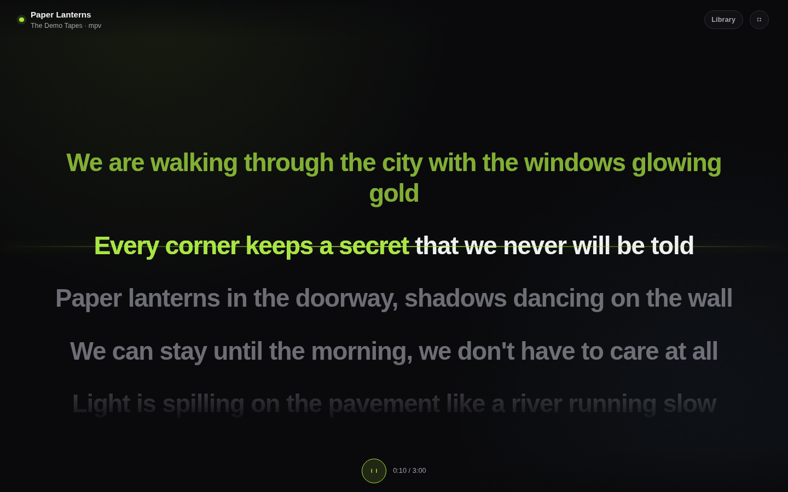
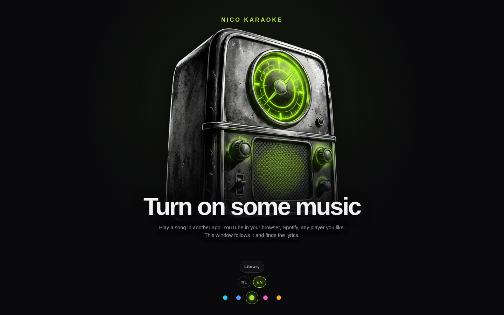
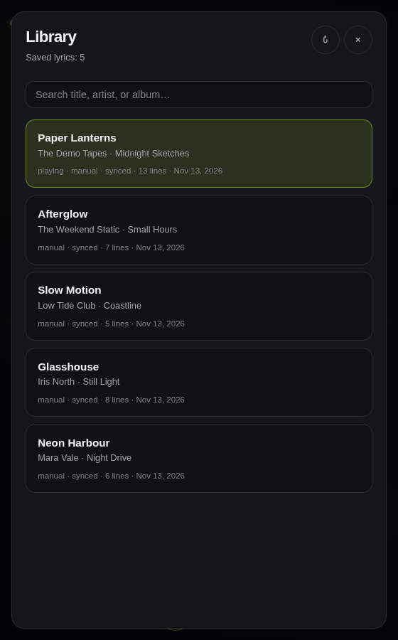
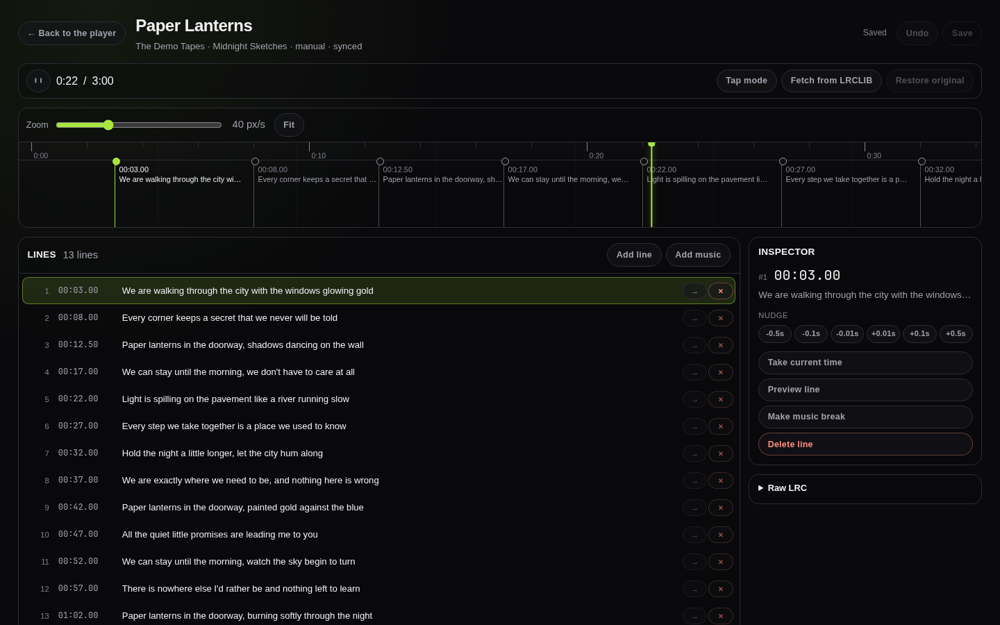

<p align="center">
  
</p>

<h1 align="center">Nico Karaoke</h1>

<p align="center">
  Karaoke lyrics for whatever is playing in another app.
</p>

<p align="center">
  <a href="../../releases">
    
  </a>
  <a href="../../releases">
    
  </a>
</p>

<p align="center">
  <a href="../../releases">All releases</a> ·
  <a href="#for-developers">Build from source</a>
</p>

Nico Karaoke follows the song you are playing in YouTube, Spotify, or another media player and
shows its lyrics line by line in a clean window. It does not record audio, download tracks, or
require an account.

<p align="center">
  
</p>

<p align="center">
  
</p>

## What it does

- Follows the song playing in your browser or media player, on Linux and Windows.
- Fetches synchronised lyrics from [LRCLIB](https://lrclib.net/); no account or API key.
- Shows the active line filling green, including lines that wrap over several visual lines.
- Keeps a searchable local library; the current song is listed first.
- Includes a Studio for fixing text and timing, with tap mode and raw LRC editing.
- Stays local: no audio capture, telemetry, analytics, or uploads.
- English and Dutch interface.

## How to use

1. Install the app from the [Releases page](../../releases).
2. Play a song in YouTube, Spotify, or another supported player.
3. Open Nico Karaoke. It follows the song and finds the lyrics.
4. Press Space to play or pause, F for fullscreen, or open the Library to browse saved lyrics.

| Input | Action |
| --- | --- |
| `Space` | play / pause the followed player |
| `F` | toggle fullscreen |
| `Library` | open the searchable library |
| `NL` / `EN` | switch language on the idle screen |
| Accent dots | switch the accent colour on the idle screen (remembered) |

Open an item in the **Studio** to correct its text or timing. The Studio never writes without an
explicit save (`Ctrl`/`Cmd` + `S`); it also has tap mode for timing a song from scratch.

## Library and Studio

The Library keeps every saved lyric and puts the current song first. Open the Studio to fix a
line or retime a song; tap mode lets you time a whole song by pressing Space at each line.

<p align="center">
  
</p>

<p align="center">
  
</p>

## What you need

- **Linux:** a desktop player that publishes MPRIS metadata. Most players and browser media
  sessions do.
- **Windows:** an app that publishes SMTC metadata, such as the system media controls from a
  supported player or browser.
- An internet connection for the lyric lookup. Playback stays in your own player.
- No account. The app only reads local player metadata and never captures audio.

If more than one player is active, choose the one to follow in the top bar.

## Your data and privacy

Everything stays local:

- Linux: `~/.local/share/nico-karaoke/`
- Windows: the app's local data folder under `%LOCALAPPDATA%` (look for the `nico-karaoke`
  folder)

The `library/` folder contains one `.lrc` and one `.json` file per saved song. The same folder
holds `nico-karaoke.log` and its backups. Lyrics are requested from LRCLIB when needed; nothing
is uploaded and there is no account, telemetry, analytics, or remote logging.

Set `NICO_KARAOKE_DATA` to use a different data directory (development and portable use).

## If something does not work

- **No lyrics appear:** LRCLIB may not have that song. Open the Studio and use **Fetch**, or
  check the title and artist in your player.
- **The app does not follow my player:** make sure the player publishes MPRIS on Linux or SMTC
  on Windows. With multiple players, pick one in the top bar.
- **The lyrics are out of sync:** open the Studio and nudge the line or use tap mode.
- **Something else:** open an issue on GitHub with the app version, your OS, the player, and
  what you expected.

## For developers

Nico Karaoke is a Rust workspace with a strict TypeScript UI and a Tauri 2 desktop shell. The
browser fallback uses the same local server, so the core, API, and web UI do not depend on the
desktop shell.

### Stack

- **Backend:** Rust stable, Tokio, Axum, Serde, Reqwest.
- **Media:** MPRIS through `zbus` on Linux; SMTC through the `windows` crate on Windows. Both
  sit behind a common provider trait.
- **Frontend:** strict TypeScript with Vite. The player is framework-free so the lyrics view
  can animate cheaply.
- **Desktop shell:** Tauri 2 in `src-tauri`, sharing the server runtime in `crates/server`.
- **Data:** one human-readable `.lrc` file and one `.json` metadata file per song.

### Requirements

- Rust stable
- Node.js 22.12 or newer (LTS recommended)
- On Linux, a running media player that publishes MPRIS metadata, and WebKitGTK 4.1 with GTK 3
  for the desktop window
- On Windows, an application that publishes SMTC metadata

### Run locally

Install the frontend dependencies once:

```bash
npm install --prefix web
```

Then start the native window:

```bash
npm run app
```

That builds the frontend and starts the Tauri shell. The shell starts the local server itself,
opens a window at its bound `127.0.0.1` URL, and uses the same data directory and log file as
the browser build. Closing the window stops the process and its server.

For frontend hot reload inside the native window:

```bash
npm run app:hmr
```

This starts Vite and the shell together, with the shell's own server on port `8770`. Keep that
port free; the Vite proxy targets it.

The browser fallback uses the same server:

```bash
npm run build --prefix web
cargo run -p nico-karaoke-server
```

Open <http://127.0.0.1:8770/>. The server tries the next free port when `8770` is busy. The
default frontend directory is `web/dist` relative to the current working directory; the server
also checks next to its executable and under `../share/nico-karaoke/web`, so a packaged build
works from any working directory. Set `NICO_KARAOKE_WEB` to override the path explicitly.

For browser development, run the server and Vite side by side:

```bash
cargo run -p nico-karaoke-server
npm run dev --prefix web
```

Vite proxies `/api` to the Rust server. Open the URL printed by Vite.

TypeScript is pinned to the 6.0.x line because `typescript-eslint` currently supports
TypeScript `<6.1`. Revisit the pin when the lint toolchain supports TypeScript 7.

### Configuration

| Setting | Environment variable | Default |
| --- | --- | --- |
| Data directory | `NICO_KARAOKE_DATA` | platform local data directory |
| Frontend build | `NICO_KARAOKE_WEB` | `web/dist` (falls back to assets embedded in the binary) |
| Log filter | `RUST_LOG` | server info, HTTP warnings |

Command-line options:

| Option | Meaning |
| --- | --- |
| `--host <addr>` | address to bind: an IP literal or `localhost` (default `127.0.0.1`) |
| `--port <port>` | first port to try (default `8770`; `0` picks a free port) |
| `--browser` | requested browser launch; automatic opening is not implemented yet |
| `--no-open` | start the server without opening anything |
| `-h`, `--help` | show usage |
| `-V`, `--version` | show the version |

The desktop shell accepts only a loopback host (`127.0.0.1`, `::1`, or `localhost`); a public
bind belongs to the server binary. The desktop shell also rejects `--browser` and `--no-open`
because it always opens its own window.

### Data

The app stores its library in the platform data directory, under `library/`. Each song has
two files:

- a human-readable `.lrc` file with the working lyrics;
- a `.json` file with metadata, source, offset, timestamps, and the preserved original.

A manual `.lrc` edit wins over the JSON copy. Metadata-only updates keep that manual text.
Files are written atomically. There is one working text per song and no on-disk version
history; the first saved original is kept for restore. The legacy Python library is not read
or migrated.

The data directory also contains `nico-karaoke.log` for the desktop and windowless builds. At
startup a file of 5 MiB or more is rotated to `.1`; three backups are kept. Use
`NICO_KARAOKE_DATA` to point the app at another directory.

### Lyrics lookup

LRCLIB is queried without an API key. Titles and channel-style artist names are cleaned
first. The lookup tries an exact match with the album, then without it, then searches within
five seconds of the known duration. A synchronised result wins over plain text, and a miss is
cached for one hour. A temporary network failure is not cached as a miss.

### Media providers

Linux follows players through MPRIS on the session bus. Windows follows sessions through
SMTC. Both expose the same provider trait and never capture audio.

With a player active, the developer probe prints what the backend sees:

```bash
cargo run -p nico-karaoke-platform --example media_probe
```

### Player behaviour

The player follows the current track and keeps the active lyric on the centre line. The
active line fills green until the next line or a `♪` break. A line that wraps over several
visual lines fills in reading order, so a short last line does not turn green early. Upcoming
lines are lighter and past lines fade; unsynchronised lyrics fall back to a readable
scrollable list.

The top bar and the transport bar stay visible while playing, so the controls are always
reachable and nothing fades in or out.

### Library

The library opens from the player and lists every saved text. Search filters by title,
artist, or album. The current track is listed first. Each item shows its source, sync state,
line count, update date, current badge, and whether an original is kept.

Open an item to preview its saved text, open it in the Studio, delete it, or search for it
on YouTube or Spotify. Editing, restoring the original, and timing all live in the Studio.

### Studio

The Studio is a separate page, served at `/editor`. Open it from a library item, or visit
`/editor` to edit the current track. It loads one song at a time and never writes without an
explicit save. The Studio uses the language and accent chosen on the player's idle screen; both
switches live there.

- Header: title, artist, source, original availability, play/pause, position, duration, save,
  dirty state, and fetch/restore actions. Play/pause controls the followed player and is
  disabled when the open item is not the current track.
- Timeline: time ruler, one marker per line, a moving playhead, zoom from 5 to 120 px/s, fit,
  click-to-seek, and drag-to-retime. Marker labels appear only when they fit.
- Lines: inline time and text editing, re-sorting on a time change, add line, add `♪` music
  marker, jump to a line, and delete. Undo covers structural changes and text edits.
- Inspector: nudges, take current time, preview the line with pre-roll/post-roll, toggle a
  music marker, and delete.
- Tap mode in the transport bar: counts down, plays from the start, shows surrounding lines,
  assigns the current time to each line on Space/Enter or a tap, applies a configurable
  correction (default −0.2 s), and supports Backspace.
- Raw LRC: view and replace the whole text. Parsing happens on the server so the editor and
  player share one parser.
- Legacy `[end:]` tags are converted to `♪` markers on open where there is a real gap; they
  are only removed from disk when you save.

| Input | Action |
| --- | --- |
| `Ctrl`/`Cmd` + `S` | save |
| `Ctrl`/`Cmd` + `Z` | undo (when focus is not in a text field) |
| `Space` | play / pause |
| `←` / `→` | nudge the selected line by 0.1 s |
| `Shift` + `←` / `→` | nudge by 0.5 s |
| `Alt` + `←` / `→` | nudge by 0.01 s |
| `Backspace` (tap mode) | undo the last tap |
| `Esc` (tap mode) | stop tapping |

### Local API

The local HTTP API returns JSON and never caches responses. It is only reachable from this
machine: a missing or foreign `Host` and a foreign `Origin` are rejected, so binding the server
to another interface does not grant remote access. API writes require JSON and a bounded
body. Every response carries `X-Content-Type-Options: nosniff`, `X-Frame-Options: DENY`,
`Referrer-Policy: no-referrer`, `Cross-Origin-Opener-Policy: same-origin`, and a self-only
content security policy. Static serving rejects path traversal.

| Method | Path | Purpose |
| --- | --- | --- |
| `GET` | `/api/health` | server and platform status |
| `GET` | `/api/now` | current track, players, and lyrics state |
| `POST` | `/api/player` | choose the followed player |
| `POST` | `/api/control` | play, pause, or seek |
| `GET` | `/api/library` | library summaries |
| `POST` | `/api/library` | create a library item |
| `GET` | `/api/library/{key}` | full library item |
| `PUT` | `/api/library/{key}` | save edited text |
| `DELETE` | `/api/library/{key}` | delete an item |
| `POST` | `/api/library/{key}/original` | restore the saved original; send `{}` as JSON |
| `POST` | `/api/lyrics` | save text for the current track |
| `POST` | `/api/lyrics/parse` | parse raw LRC for the Studio without writing |
| `POST` | `/api/lyrics/offset` | update the current offset |
| `POST` | `/api/lyrics/fetch` | look up lyrics for the current track or a library item; `apply` stores them |

Errors use stable codes such as `forbidden_host`, `no_current_track`, `track_changed`,
`lyrics_not_found`, `invalid_json`, and `unsupported_media_type`.

`signature` identifies the current track by normalised artist and title; `record_key`
identifies the library file. `item_key` in lookup requests is a library key.

### Checks

The workspace includes the Tauri shell, so a full Linux test needs the WebKitGTK 4.1 and GTK 3
development packages in addition to the runtime libraries.

```bash
cargo fmt --all -- --check
cargo clippy --workspace --all-targets --locked -- -D warnings
cargo test --workspace --locked
cargo check -p nico-karaoke-platform --all-targets --target x86_64-pc-windows-msvc
npm run typecheck --prefix web
npm run lint --prefix web
npm run format:check --prefix web
npm test --prefix web
npm run build --prefix web
npm audit --prefix web
```

See `docs/testing.md` for the manual player matrix, accessibility notes, and the long-song
measurements. Dependencies have no npm advisories; the ESLint toolchain pins a fixed `minimatch`
through a package override.

### CI and test builds

`.github/workflows/ci.yml` runs the Rust checks on Linux and Windows and the web checks on
Linux for pushes to `main` and pull requests. Documentation-only changes are skipped.

The **Build test artifacts** workflow can be started manually from the Actions tab. It produces
an unsigned Linux `.tar.gz` and a Windows zip, each containing a self-contained desktop
executable (plus the README and licence). The frontend is embedded in the executable, so there
is no separate `web` folder to keep next to it. The Windows build is a test build, not an
installer; SmartScreen may warn because it is not code-signed yet.

### Repository layout

```text
.github/           CI and test-build workflows
crates/core/       domain logic and configuration
crates/platform/   MPRIS and SMTC boundary
crates/server/     local Axum server, runtime, and static assets
src-tauri/         Tauri 2 desktop shell
web/               Vite + strict TypeScript UI
scripts/           local developer helpers
docs/              roadmap and testing evidence
```

## Licence

The source code, documentation, and app icon are MIT licensed; see `LICENSE`.
