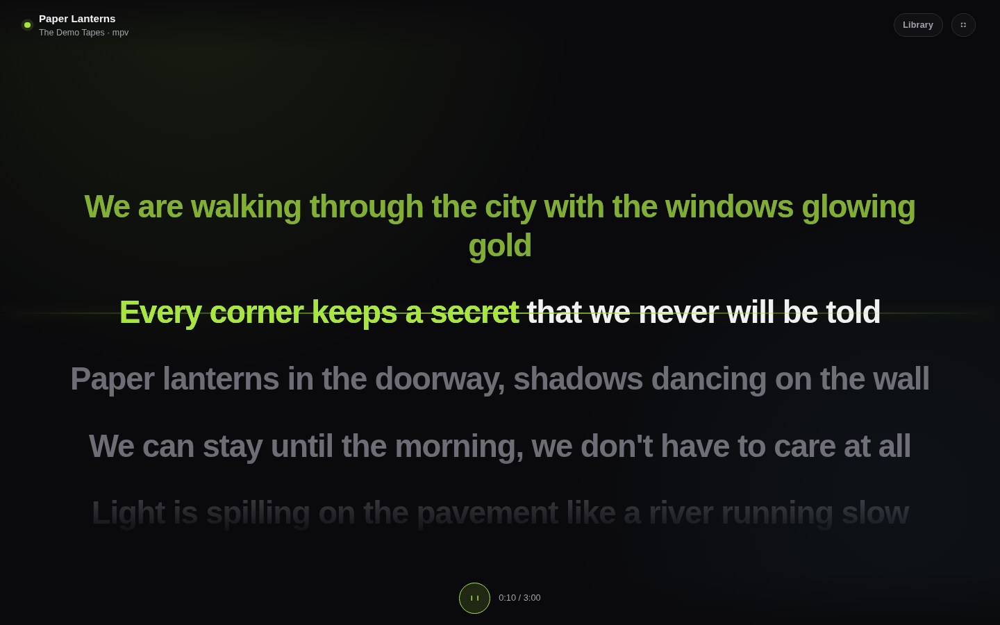
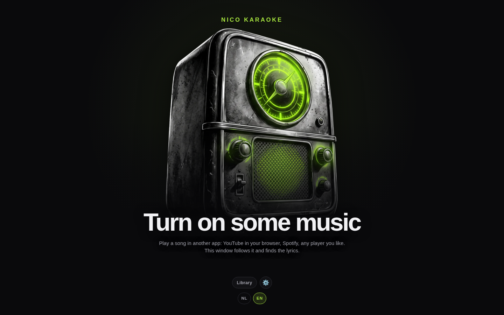
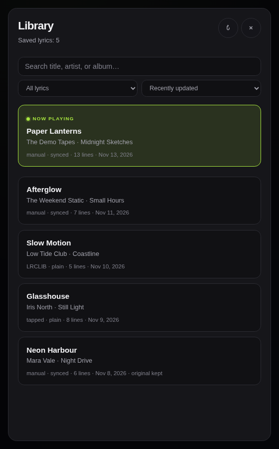
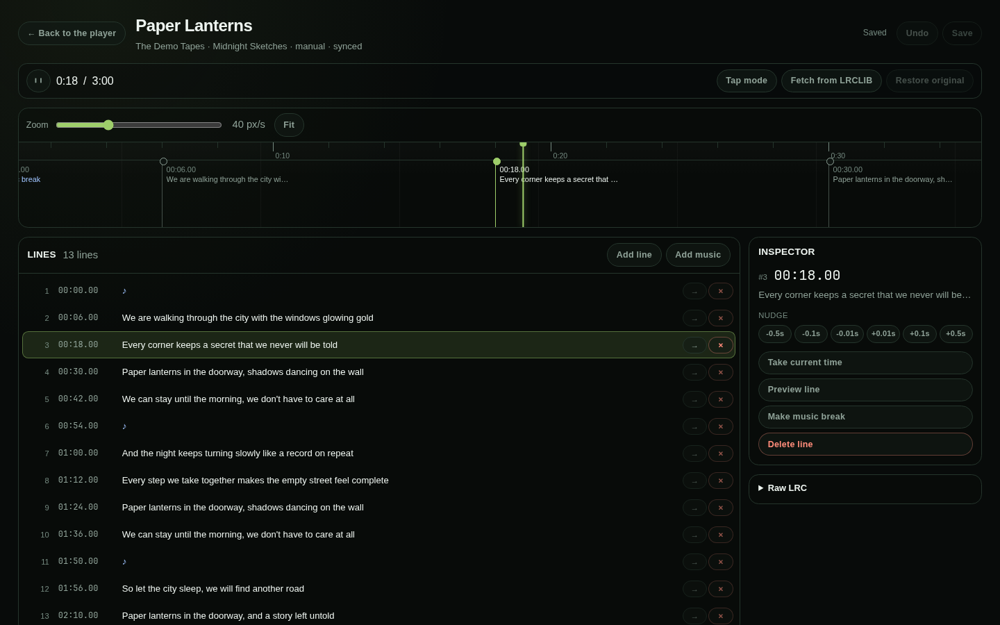

<p align="center">
  
</p>

<h1 align="center">Nico Karaoke</h1>

<p align="center">
  Karaoke lyrics for whatever is playing in another app.
</p>

<p align="center">
  <a href="../../releases">
    
  </a>
  <a href="../../releases">
    
  </a>
</p>

<p align="center">
  <a href="../../releases">All releases</a> ·
  <a href="CHANGELOG.md">Changelog</a> ·
  <a href="#for-developers">Build from source</a>
</p>

Nico Karaoke follows the song you are playing in YouTube, Spotify, or another media player and
shows its lyrics line by line in a clean window. It does not record audio, download tracks, or
require an account.

<p align="center">
  
</p>

<p align="center">
  
</p>

## What it does

- Follows the song playing in your browser or media player, on Linux and Windows.
- Fetches synchronised lyrics from [LRCLIB](https://lrclib.net/); no account or API key.
- Shows the active line filling green, including lines that wrap over several visual lines.
- Keeps a searchable local library; the current song is listed first.
- Includes a Studio for fixing text and timing, with tap mode and raw LRC editing.
- Installs signed updates from the Settings panel, with an optional startup notice.
- Stays local: no audio capture, telemetry, analytics, or content uploads.
- English and Dutch interface.

## Download and install

Download the latest release from the [Releases page](../../releases). Linux uses a single
AppImage; Windows uses a per-user NSIS installer. Both support signed in-app updates.

### Linux (x86_64)

1. Download `NicoKaraoke-<version>-linux-x86_64.AppImage`.
2. Make it executable and run it: `chmod +x NicoKaraoke-*.AppImage && ./NicoKaraoke-*.AppImage`.

The AppImage bundles WebKitGTK and the other runtime libraries. It needs FUSE 2 and a working
graphics stack. If it does not start, install FUSE 2 (`fuse2` on Arch, `libfuse2t64` on
Ubuntu 24.04, `libfuse2` on older Debian/Ubuntu). Keep the AppImage in a writable folder so it
can replace itself during an update.

The AppImage is the auto-updating Linux build. A package-managed install (`.deb` or Arch
package) updates through its package manager instead and is not offered yet.

### Windows (x86_64)

1. Download `NicoKaraoke-<version>-windows-x86_64-setup.exe` and run it.
2. The installer is per-user and does not require administrator rights.

Windows needs the WebView2 runtime; Windows 11 includes it and most Windows 10 systems already
have it. The build is not code-signed, so SmartScreen may show an "Unknown publisher" warning.
The update signature is separate from Windows code signing and protects the downloaded update,
not the first installer.

Each release also includes `SHA256SUMS.txt`. On Linux, run `sha256sum -c SHA256SUMS.txt` in the
download folder; on Windows, compare the installer with
`Get-FileHash <installer> -Algorithm SHA256`.

### Updating and uninstalling

- **Updates:** open **Settings → Check for updates**. The first updater-enabled release must
  be installed once manually; after that the app can update itself. A release build checks at
  startup, shows a badge on the gear, and shows a one-time toast when a newer version is
  available. Installing an update always requires confirmation.
- **Linux AppImage:** an update replaces the AppImage file. To uninstall, delete the AppImage.
  The data folder `~/.local/share/nico-karaoke/` remains; delete it to remove saved lyrics and
  logs.
- **Windows:** uninstall through **Settings → Apps → Installed apps → Nico Karaoke →
  Uninstall**. The data folder remains; delete it to remove saved lyrics and logs.

## How to use

1. Install the app for your platform; see [Download and install](#download-and-install).
2. Play a song in YouTube, Spotify, or another supported player.
3. Open Nico Karaoke. It follows the song and finds the lyrics.
4. Press Space to play or pause, F for fullscreen, or open the Library to browse saved lyrics.

| Input | Action |
| --- | --- |
| `Space` | play / pause the followed player |
| `F` | toggle fullscreen |
| `Library` | open the searchable library |
| `NL` / `EN` | switch language on the idle screen |
| Settings gear | choose the accent colour; the choice is remembered |

## Library and Studio

The Library keeps every saved lyric and puts the current song first, marked **Now playing**.
Search by title, artist, or album, filter on Synced, Needs timing, or My edits, and sort by
last update, title, or artist. Open an item in the Studio to fix text or timing; tap mode lets
you time a whole song by pressing Space at each line. When the current song has no lyrics yet,
choose **New lyrics** in the header to type or paste your own text.

<p align="center">
  
</p>

<p align="center">
  
</p>

### Settings

The gear button opens the settings panel. It is available in the top bar while a song is
playing or paused, on the idle screen, and in the Studio. The panel holds the accent colour,
with the choice remembered on this device and applied to the player, lyrics highlight, library,
and Studio.

The language switch stays on the idle screen: it is normally a one-time choice and does not
need to be reachable during playback.

## What you need

- **Linux:** a desktop player that publishes MPRIS metadata. Most players and browser media
  sessions do.
- **Windows:** an app that publishes SMTC metadata, such as the system media controls from a
  supported player or browser.
- An internet connection for the lyric lookup. Playback stays in your own player.
- No account. The app only reads local player metadata and never captures audio.

If more than one player is active, choose the one to follow in the top bar.

## Your data and privacy

Everything stays local:

- Linux: `~/.local/share/nico-karaoke/`
- Windows: the app's local data folder under `%LOCALAPPDATA%` (look for the `nico-karaoke`
  folder)

The `library/` folder contains one `.lrc` and one `.json` file per saved song. The same folder
holds `nico-karaoke.log` and its backups. Lyrics are requested from LRCLIB when needed; nothing
is uploaded and there is no account, telemetry, analytics, or remote logging.

A release build checks GitHub Releases for a signed update when it starts. That request carries
no personal data, and an update is downloaded and installed only after you confirm it in
Settings. Development builds and the browser fallback do not check for updates.

## If something does not work

- **No lyrics appear:** LRCLIB may not have that song. Choose **New lyrics** in the Library to
  type or paste your own text, or open the Studio and use **Fetch** after checking the title
  and artist in your player. A video with a long intro or outro, or a different edit, is
  deliberately not forced to match the song's length. See
  [Lyrics lookup](docs/development.md#lyrics-lookup) for the duration rule. Try the same song
  in YouTube Music first.
- **The app does not follow my player:** make sure the player publishes MPRIS on Linux or SMTC
  on Windows. With multiple players, pick one in the top bar.
- **The lyrics are out of sync:** open the Studio and nudge the line or use tap mode.
- **No update is offered:** only the AppImage and the Windows installer can update themselves.
  Development builds and the browser fallback do not check. Open **Settings** to see the
  version and run a manual check.
- **An update fails:** retry from **Settings**; GitHub Releases must be reachable. If it keeps
  failing, install the latest release from the Releases page.
- **Something else:** open an issue on GitHub with the app version, your OS, the player, and
  what you expected.

## For developers

Nico Karaoke is a Rust workspace with a strict TypeScript UI and a Tauri 2 desktop shell. The
browser fallback uses the same local server, so the core, API, and web UI do not depend on the
desktop shell.

```bash
npm install --prefix web
npm run app
```

That builds the frontend and starts the Tauri shell. The shell starts the local server itself,
opens a window at its bound `127.0.0.1` URL, and uses the same data directory and log file as
the browser build.

See [`docs/development.md`](docs/development.md) for the stack, requirements, all run modes,
configuration, data format, lyrics lookup, media providers, player and Studio internals, the
local API, checks, CI, releases, and the repository layout.

## Licence

The source code, documentation, and app icon are MIT licensed; see `LICENSE`.
